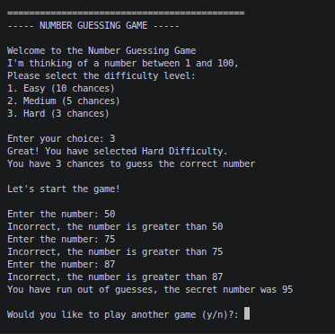

# HILO | Higher or Lower Number Guessing Game

HILO is a full-stack number guessing game built with React and FastAPI. Players create an account, choose a difficulty, and attempt to guess a randomly generated number with higher-or-lower hints. The application also records player statistics and provides a leaderboard.

**Live application:** https://hilo-ochre.vercel.app/



## Table of Contents

- [Features](#features)
- [Tech Stack](#tech-stack)
- [Screenshots](#screenshots)
- [Prerequisites](#prerequisites)
- [Local Development](#local-development)
- [Environment Variables](#environment-variables)
- [Running the Application](#running-the-application)
- [API Documentation](#api-documentation)
- [Project Structure](#project-structure)
- [Engineering Notes](#engineering-notes)
- [Contributing](#contributing)

## Features

- User registration and login with JWT authentication
- Protected gameplay and account routes
- Easy, medium, and hard difficulty levels
- Higher-or-lower hints and attempt tracking
- Player game history and profile statistics
- Leaderboard filtered by difficulty
- Database-backed game and user records
- Login and signup rate limiting
- Responsive interface for desktop and mobile

## Tech Stack

### Frontend

- React 19
- TypeScript
- Vite
- Tailwind CSS
- React Router

### Backend

- Python
- FastAPI
- SQLModel and SQLAlchemy
- PostgreSQL through Supabase
- JWT authentication
- SlowAPI rate limiting
- Uvicorn

### Deployment

- Vercel

## Screenshots

### Landing Page


### Authentication


### Gameplay


### Leaderboard


## Prerequisites

Install the following before running the project locally:

- Node.js 20 or newer
- npm
- Python 3.11 or newer
- A Supabase project or PostgreSQL database

## Local Development

Clone the repository:

```bash
git clone https://github.com/Muelvzz/number-guessing-game.git
cd number-guessing-game
```

### 1. Set up the backend

```bash
cd app
python -m venv .venv
source .venv/bin/activate
pip install -r requirements.txt
```

Create `app/.env` for the backend environment variables described below.

### 2. Set up the frontend

In a separate terminal:

```bash
cd frontend
npm install
```

Create `frontend/.env` if you need to override the default API URL:

```env
VITE_API_URL=http://127.0.0.1:8000
```

## Environment Variables

### Backend

Create `app/.env` with the following values:

```env
POSTGRES_PASS=your_supabase_postgres_password
JWT_SECRET=your_secure_random_secret
JWT_ALGORITHM=HS256
CLIENT_URL=http://localhost:5173
LOCALHOST_URL=http://localhost:5173
```

| Variable | Description |
| --- | --- |
| `POSTGRES_PASS` | PostgreSQL or Supabase database password |
| `JWT_SECRET` | Secret key used to sign and verify JWT access tokens |
| `JWT_ALGORITHM` | JWT signing algorithm |
| `CLIENT_URL` | Allowed frontend origin in non-local environments |
| `LOCALHOST_URL` | Allowed local frontend origin |

Use a secure random value for `JWT_SECRET`. Never commit `.env` files or database credentials to Git.

## Running the Application

Start the backend from the `app` directory:

```bash
source .venv/bin/activate
uvicorn app.main:app --reload
```

The backend will be available at `http://127.0.0.1:8000`.

Start the frontend from the `frontend` directory:

```bash
npm run dev
```

Open `http://localhost:5173` in your browser.

### Other frontend commands

```bash
npm run build   # Create a production build
npm run lint    # Run ESLint
npm run preview # Preview the production build locally
```

## API Documentation

With the backend running, open:

- Swagger UI: `http://127.0.0.1:8000/docs`
- Scalar API reference: `http://127.0.0.1:8000/scalar`

### Main route groups

| Route group | Purpose |
| --- | --- |
| `/` | Landing Page |
| `/user` | Registration, login, logout, and account data |
| `/game` | Game creation, and updates |
| `/leaderboard` | Leaderboard Data |

## Project Structure

```text
.
├── app/
│   ├── app/
│   │   ├── api/
│   │   │   ├── routes/       # User and game endpoints
│   │   │   └── schemas/      # Request and response models
│   │   ├── core/             # Authentication and security
│   │   ├── database/         # Database session and models
│   │   ├── service/          # User and game business logic
│   │   ├── config.py         # Environment configuration
│   │   └── main.py           # FastAPI application entry point
│   └── requirements.txt
├── frontend/
│   └── src/
│       ├── components/       # Reusable UI components
│       ├── hooks/            # Authentication and user state
│       ├── pages/            # Application routes
│       ├── provider/         # Context providers
│       ├── service/          # Backend API clients
│       └── types/            # Shared TypeScript types
```

## Engineering Notes

- PostgreSQL was selected over a document database to support relational user, game, and leaderboard data.
- Supabase provides the hosted PostgreSQL database.
- SQLModel and SQLAlchemy provide database models and session management.
- JWT access tokens authenticate protected endpoints.
- SlowAPI applies fixed-window rate limits to account creation and login.
- The React frontend uses Vite environment variables for API configuration.

## Future Improvements

- Add automated backend and frontend test suites
- Expand public API rate limiting
- Add Docker support for repeatable local setup
- Improve database configuration for any PostgreSQL deployment
- Add CI checks for linting and builds
- Improve account recovery and session management

## Contributing

Contributions and suggestions are welcome. Please open an issue or submit a pull request with a clear description of the proposed change.
